<picture>
  <source media="(prefers-color-scheme: dark)" srcset="./dark.svg">
  <source media="(prefers-color-scheme: light)" srcset="./light.svg">
  
</picture>

# Hi, I'm Ryno 👋

I'm a junior software developer and student based in South Africa. I enjoy building practical software solutions, working across backend and web development, and developing my understanding of databases and software architecture.

## About

- **Current role:** Student
- **Professional focus:** Software development, backend development, web development and database management
- **Work-integrated learning:** Practical project experience through WIL projects
- **Currently interested in:** Building useful applications, improving code quality and learning new technologies

## Featured projects

| Project | Overview |
|---|---|
| **Student Assignment & Quiz Reminder System** | A web application for managing student assignments and quiz reminders. |
| **Worksheet Factory Application** | A software application for creating and managing worksheets, including PDF generation. |
| **Company Website** | Website development completed as part of work-integrated learning. |
| **Inventory Management System** | A project focused on inventory management workflows. |

## Engineering stack

**Languages & web:** JavaScript · TypeScript · Python · Java · HTML5 · CSS3

**Frontend:** React · Next.js

**Backend:** Node.js · Express.js · REST APIs

**Databases:** MySQL · PostgreSQL · SQL

**Tools & practices:** Git · GitHub · Figma · MVC · UML · Database design · ERD · API design

## Education

- **Occupational Certificate (NQF Level 5)** — CTU Stellenbosch (2025–2026)
- **National Senior Certificate** — Parel Vallei High School (2020–2024)

## Certifications

- Microsoft Azure Fundamentals (AZ-900)
- Microsoft Azure Data Fundamentals (DP-900)
- IT Specialist – Python
- IT Specialist – HTML & CSS
- IT Specialist – JavaScript

## Connect

- **GitHub:** [@RynoDeKoker](https://github.com/RynoDeKoker)
- **LinkedIn:** [Ryno-De-Koker](https://www.linkedin.com/in/Ryno-De-Koker/)
- **Email:** [ryno11.dekoker@gmail.com](mailto:ryno11.dekoker@gmail.com)

---

Motivated by continuous learning, practical problem-solving and building effective software solutions.
